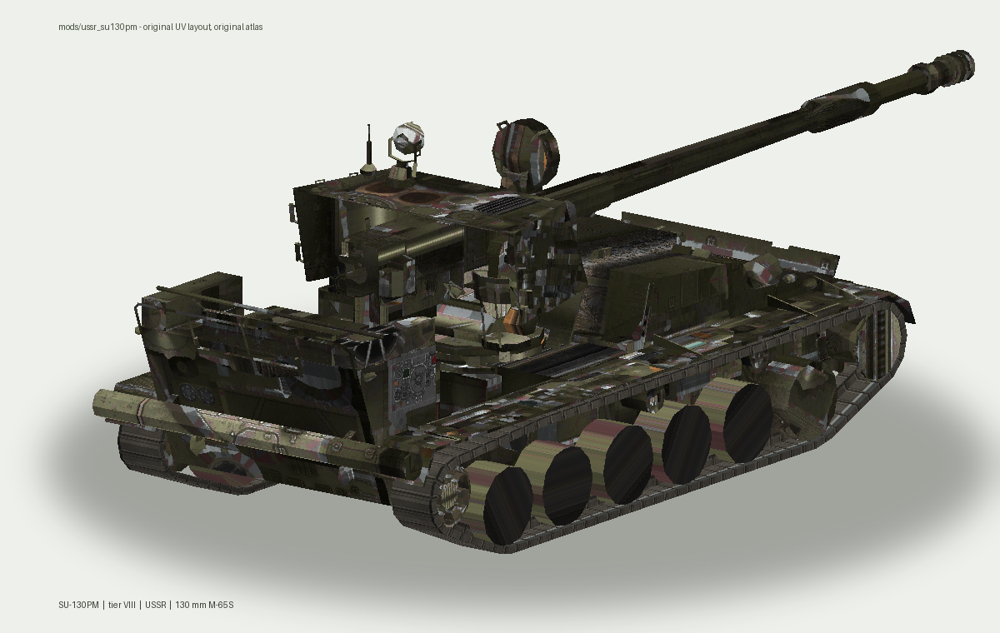

# mods-to-blitz-legacy

Моды танков для World of Tanks Blitz (legacy). Каждый мод лежит в отдельной
папке `mods/` и повторяет структуру игровых ресурсов:

```
mods/<название мода>/
├── assets/tanks/     модель, текстуры, иконки (+ .import Godot)
└── tanks_mod/        .tres с описанием танка
```

## Пятый танк — СУ-130ПМ

| Мод | Танк | Нация / класс | Архив |
|---|---|---|---|
| [`mods/ussr_su130pm`](mods/ussr_su130pm) | **СУ-130ПМ** | СССР, ПТ-САУ, VIII ур. | [`ussr_su130pm_install.zip`](ussr_su130pm_install.zip) |



Мод собран из `tank5/`: пересобранная иерархия корпус / рубка / орудие,
11 колёс на борт, **родная UV-развёртка новой модели** и потому оригинальный
DDS-атлас один к одному (только V-перевёрнут, как в остальных модах), плюс
отдельная текстура траков, большая и маленькая иконки и `.tres` с ТТХ Blitz.
Подробности и скрипты пересборки — в
[`mods/ussr_su130pm/README.md`](mods/ussr_su130pm/README.md).

Установка: распаковать **содержимое** `ussr_su130pm_install.zip` в корневую
папку игры (где лежит `assets/`). Файлы `.import` движок создаёт сам.

## Эталонные моды

Эти четыре моды лежали в `main` и используются как образец формата `.tres`,
`.import` и структуры ассетов:

| Мод | Танк |
|---|---|
| `mods/germany_mauses` | Maus |
| `mods/germany_tashenratte` | Tashenratte |
| `mods/russian_object279` | Объект 279 |
| `mods/sturmtiger` | Sturmtiger |

## Исходники

| Папка | Что лежит |
|---|---|
| `tank1/` | 60TP Lewandowskiego — модель, текстуры, иконка |
| `tank2/` | Waffenträger E 110 — модель, текстуры, иконка |
| `tank3/` | ЛВ-1300 Уран — модель без UV, атлас, иконки |
| `tank4/` | МС-11 — модель с UV и вшитыми текстурами, иконка |
| `tank5/` | СУ-130ПМ — модель с UV и материалами, DDS-атлас, иконки |

Первые четыре мода из этих исходников уже сделаны в ветке
`arena/6bca88e5-mods-to-blitz-legacy` (PR #1). Пятый собран в этой ветке.

## Пересборка пятого мода

```bash
python3 -m pip install pillow

python3 mods/ussr_su130pm/tools/make_glb.py
python3 mods/ussr_su130pm/tools/make_textures.py
python3 mods/ussr_su130pm/tools/make_imports.py
python3 mods/ussr_su130pm/tools/make_tres.py
python3 mods/ussr_su130pm/tools/make_preview.py
python3 mods/ussr_su130pm/tools/make_zip.py
```
